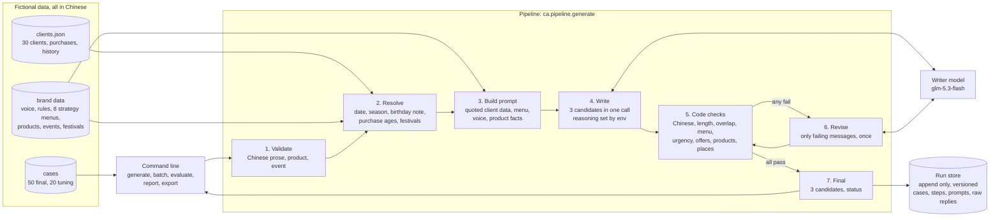
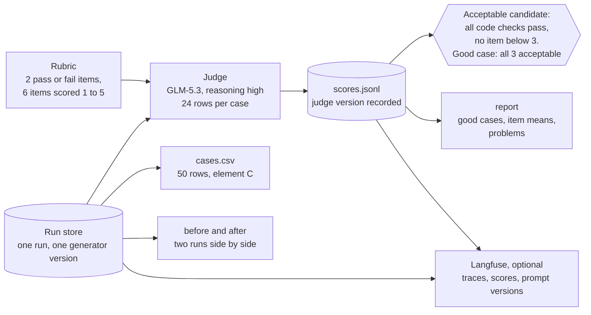
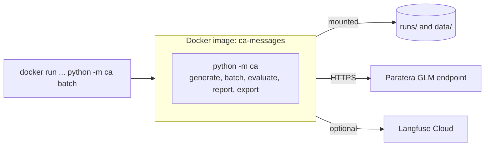

# Architecture

The tool is one fixed pipeline run from the command line, a run store that never overwrites, and a separate scoring step.

## Generating three messages

## Scoring and reporting

## Deployment

The command line ships in one Python 3.12 image. Mount `runs/` and `data/` so results stay on the host.

